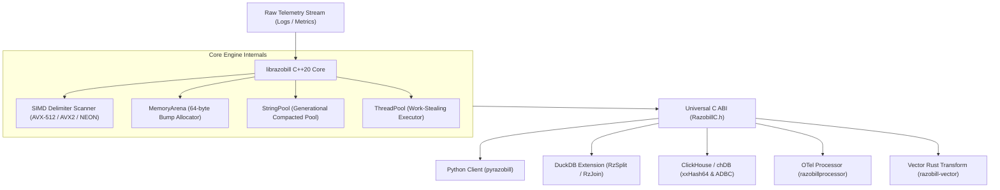

# Systems architecture overview

[Docs](../README.md) > [Explanations](../README.md#4-explanations-and-architecture-understand) > Systems architecture overview

A modular monolith design for high-throughput telemetry decomposition and reconstruction.
Read this article if you want to understand how librazobill manages memory, vectorization, and language bindings.
Skip this article if you are only writing queries in DuckDB or Python.

---

## Architectural philosophy

Razobill is engineered around three core systems constraints:

1. **Zero heap allocation on the hot path**: Parsing an incoming line must not invoke `malloc`, `new`, or standard container reallocations.
2. **Data-oriented cache contiguity**: Struct-of-Arrays (SoA) layout guarantees sequential CPU cache line prefetching.
3. **Single source of truth**: The core C++20 parsing engine compiles into a universal C ABI (`RazobillC.h`), which serves as the foundation for Python, DuckDB, Go (OTel), and Rust (Vector) adapters.

---

## Data plane versus control plane

Razobill strictly separates high-frequency data plane execution from control plane configuration:

### Data plane

- Executes per-event parsing and byte reconstruction.
- Uses thread-local scratchpads (`Scratch` buffers) pre-allocated up to steady-state capacity.
- Zero locks, mutexes, or atomic increments exist on the parsing hot path.
- In DuckDB, scalar execution directly maps raw `duckdb_string_t` pointers to result vector buffers without intermediate C++ string objects.

### Control plane

- Manages long-lived configuration, SIMD feature detection via CPUID multiversioning, and thread-pool lifecycle.
- Handles extension loading, memory ceiling adjustments, and global statistics logging.

---

## Memory management architecture

> [!NOTE]
> `MemoryArena` and `StringPool` serve as internal, cache-aligned data structures for native benchmark harnesses and standalone testing. Production table compaction utilizes database-native columnar dictionary tables and vector list allocations.

### 1. Monotonic memory arena (`MemoryArena.hpp`)

- Provides cache-line aligned (64-byte) bump allocation for standalone benchmark runs.
- When an arena is reset, backing memory blocks are retained on an internal freelist rather than released to the operating system, eliminating system call overhead across billions of calls.

### 2. Compact string pool (`StringPool.hpp`)

- Replaces standard heap-allocated string objects (`std::string`) with heterogeneous `std::string_view` lookup for benchmark harnesses.
- Employs generational mark-and-sweep garbage collection for long-running aggregators.

### 3. Thread-local scratchpad

- In multi-threaded environments (such as DuckDB vectorized execution or Python `RzSplitMany`), each OS thread accesses a thread-local working area.
- Buffers expand to steady state and are capped with an automatic retention ceiling to reclaim memory after processing oversized lines.

---

## Cross-language integration architecture

All integrations communicate with the engine through the stable C ABI declared in `include/librazobill/RazobillC.h`:

- Zero C++ runtime leakage: No C++ exceptions or mangled symbols cross foreign language boundaries.
- Error codes are communicated via standard integer enums (`RzStatus`).
- Lifetimes are explicit: `RzFree` reclaims memory allocated for decomposed records.

---

## Analytical database adapters

Razobill connects to columnar storage engines via two dedicated architectures:

1. **Direct DuckDB scalar extension**: Compiled C++ scalar functions operating directly on `duckdb_string_t` vectors.
2. **Arrow ADBC backend (`BackendAdbc.cpp`)**: Dynamic Arrow Database Connectivity driver connecting to in-process ClickHouse chDB with bit-identical `xxHash64` hash alignment across engines.

---

## Information theory: latitude, doubt, and provenance channels

Razobill models log generation through an information-theoretic framework described in *Latitude and Doubt* (M. M. Atta, 2026):

- **Latitude ($\Lambda = H(X \mid W)$)**: The conditional entropy of surface log representations $X$ given semantic intent $W$. When multiple synonymous templates or surface formats represent the same meaning, Latitude measures the available capacity for metadata embedding.
- **Doubt ($\Delta = H(W \mid X)$)**: Residual semantic uncertainty. In an unambiguous source, $\Delta = 0$, meaning the observed log line uniquely identifies its semantic intent.
- **Theorem 8 (Capacity)**: In an unambiguous semantic source ($\Delta = 0$), the capacity of the steganographic and provenance channel over synonymous template choices is strictly bounded by $\Lambda = H(X \mid W)$ bits per event.
- **Proposition 9 (Finite-precision bound)**: Distortion-free reconstruction across a sequence of length $N$ under arithmetic interval coding requires precision:

$$P = \left\lceil \sum_{i=1}^N \max_x (-\log_2 Q(x \mid w_i)) \right\rceil + s + 1 \text{ bits}$$

The implementation in `include/librazobill/Channel.hpp` realizes this channel over IEEE 754 64-bit floating point intervals (53 bits of mantissa). It operates as an internal research component and theoretical proof harness, separate from the primary database ingestion and analytical query path. When required precision $P$ exceeds mantissa precision, interval arithmetic underflow is safely caught, returning `success = false` rather than corrupting telemetry data.

---

## Related

- [Lossless invertibility mechanics](lossless-invertibility.md)
- [Data-oriented design](data-oriented-design.md)
- [Universal C ABI reference](../reference/c-abi.md)
