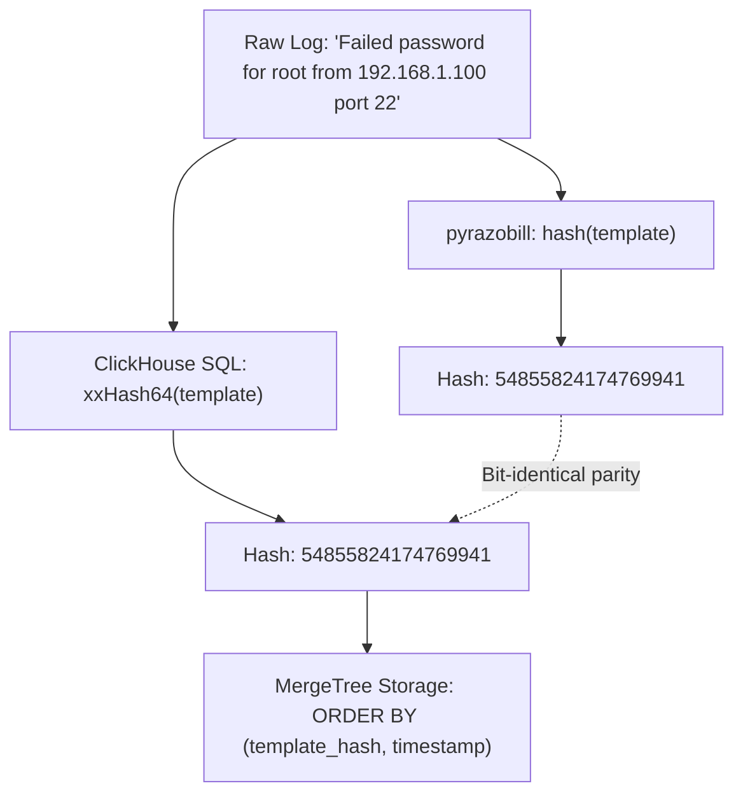

# Indexing logs in ClickHouse and chDB

[Docs](../README.md) / [How-to guides](chdb.md) / ClickHouse and chDB

This guide shows you how to integrate Razobill with ClickHouse and embedded chDB using xxHash64 template keys and additive MergeTree table indexing.

- **Who this is for**: Data engineers querying log datasets in ClickHouse or embedded chDB.
- **What you will have at the end**: An additive MergeTree table schema indexed by template hash for fast analytical aggregations.
- **Maturity**: Beta.

---

## The problem

Querying large volumes of raw log text in ClickHouse presents analytical challenges:

1. Extracting templates with regular expressions (`replaceRegexpAll`) consumes high CPU during dashboard aggregations.
2. Shuffling variable-length string messages across distributed ClickHouse nodes increases network egress overhead.
3. Decomposing lines into separate slot columns in ClickHouse MergeTree tables adds schema complexity without significant compression gain, because ClickHouse `CODEC(ZSTD(3))` already compresses raw text columns effectively.

---

## The solution: additive mode

The recommended pattern for ClickHouse is additive indexing:

1. Retain the raw message string column with `CODEC(ZSTD(3))` for full-text queries and audits.
2. Add a 64-bit template hash column (`template_hash UInt64`) indexed with `CODEC(ZSTD(3))`.
3. Use Razobill's `hash()` function, which produces an unsigned 64-bit integer bit-identical to ClickHouse `xxHash64()`.



Hash parity ensures that keys computed at the edge match in-database queries without translation.

---

## Step 1: Verify hash parity

Razobill computes a 64-bit unsigned hash (`xxh64` with seed 0).
ClickHouse provides a native `xxHash64()` scalar function.
Both generate identical numbers for any input:

```sql
SELECT xxHash64('Failed password for {s} from {s} port {i}') AS template_hash;
```

Expected output:

```text
54855824174769941
```

In Python:

```python
import pyrazobill as rz

h = rz.hash("Failed password for {s} from {s} port {i}")
print(h)
# Output: 54855824174769941
```

---

## Step 2: Configure MergeTree tables

Add a `template_hash` column to your ClickHouse table:

```sql
CREATE TABLE system_logs (
    timestamp DateTime,
    service LowCardinality(String),
    template_hash UInt64 CODEC(ZSTD(3)),
    msg String CODEC(ZSTD(3))
) ENGINE = MergeTree()
ORDER BY (service, template_hash, timestamp);
```

Ordering by `template_hash` co-locates rows with the same template on disk, enabling fast group-by aggregations without scanning string bytes.

---

## Step 3: Run queries in chDB

Embedded chDB runs ClickHouse directly inside Python processes without an external database daemon:

```python
import chdb
import pyrazobill as rz

# Compute template and hash during ingestion
line = "Failed password for root from 192.168.1.100 port 22"
rec = rz.split(line)
h = rz.hash(rec.template)

# Query using in-memory ClickHouse SQL
query = f"""
SELECT
    count(*) AS total,
    {h} AS template_hash
"""
res = chdb.query(query, "CSV")
print(res)
```

---

## How to verify

Verify that the hash generated by Razobill matches ClickHouse SQL:

```python
import chdb
import pyrazobill as rz

template_str = "Failed password for {s} from {s} port {i}"
local_hash = rz.hash(template_str)

ch_query = f"SELECT xxHash64('{template_str}')"
ch_hash = int(chdb.query(ch_query, "TabSeparated").strip())

assert local_hash == ch_hash
print("Verified: cross-engine hash parity confirmed.")
```

---

## Troubleshooting

### Missing chDB driver during integration tests

**What happened**:
Running `./build/IntegrationChdb.exe` prints:

```text
Skipping chDB test: driver library not present
```

**Why it occurs**:
The chDB embedded C driver was not installed in the build path.

**How to resolve**:
Install the python package `pip install chdb` or build `libchdb` from source if running standalone C++ integration tests.

---

## Related

- [Compacting logs in DuckDB](duckdb.md): relational struct parsing and lossless reconstruction.
- [Python developer guide](python.md): batch log parsing with `pyrazobill`.
- [Lossless invertibility](../explanation/lossless-invertibility.md): theoretical foundations.

## Template parity with DuckDB and Python

Only the hash is shared bit for bit. ClickHouse has no native scanner, so its form expression is generated SQL that
implements `ScanMode::Exact` (a token is a variable when it contains a digit; an integer token must fit `int64`;
literal braces in constant text are written `{{` and `}}`). The DuckDB extension and Python default to
`ScanMode::Semantic`, which also treats the value after keywords such as `user` or `for` as a variable. For the same
log line the two engines can therefore produce different templates and different `form_id` values. Use
`ScanMode::Exact` everywhere if template identity across engines matters.
