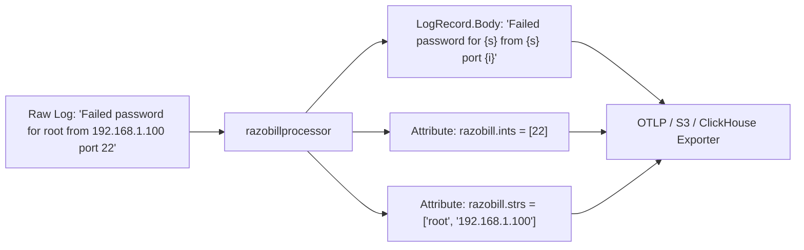

# Deploying the OpenTelemetry processor

[Docs](../README.md) / [How-to guides](opentelemetry.md) / OpenTelemetry

This guide shows you how to build and configure `razobillprocessor` inside an OpenTelemetry Collector to compact logs at the edge before transmission.

- **Who this is for**: SREs and platform engineers managing OpenTelemetry Collector DaemonSets or sidecars.
- **What you will have at the end**: A custom OpenTelemetry Collector binary that replaces raw log message bodies with compact templates and extracts parameter slices.
- **Maturity**: Beta.

---

## The problem

Edge logging pipelines transmit uncompressed, repetitive string messages across networks and cloud availability zones.
This creates high network egress costs and places heavy indexing loads on central observability clusters.

---

## The solution: razobillprocessor

The `razobillprocessor` component parses incoming `plog.LogRecord` payloads using the librazobill C ABI:

1. Replaces `LogRecord.Body` with the compact template string.
2. Extracts numeric values into a typed integer slice attribute (`razobill.ints`).
3. Extracts variable words into a string slice attribute (`razobill.strs`).



The processor strips raw string redundancy at the host edge before network egress.

---

## Prerequisites

- Go 1.25 or newer (`go version`).
- OpenTelemetry Collector Builder (`builder`) installed (`go install go.opentelemetry.io/collector/cmd/builder@v0.111.0`).
- Compiled `librazobill` C ABI shared library available in your system library path.

---

## Step 1: Configure the processor in collector YAML

Add `razobill` to the processors pipeline in your collector configuration (`config.yaml`):

```yaml
receivers:
  filelog:
    include: [/var/log/containers/*.log]

processors:
  memory_limiter:
    check_interval: 1s
    limit_percentage: 75
    spike_limit_percentage: 20

  razobill:
    drop_raw_body: true
    include_hash: true

exporters:
  otlp:
    endpoint: telemetry-gateway.internal:4317

service:
  pipelines:
    logs:
      receivers: [filelog]
      processors: [memory_limiter, razobill]
      exporters: [otlp]
```

### Configuration parameters

| Parameter | Type | Default | Description |
| :--- | :--- | :--- | :--- |
| `drop_raw_body` | boolean | `true` | Overwrites `LogRecord.Body` with the template string. |
| `include_hash` | boolean | `true` | Populates `razobill.formHash` with the 64-bit template hash. |

---

## Step 2: Build with the OpenTelemetry collector builder

Use the manifest provided in `ext/otel/BuilderConfig.yaml`:

```yaml
dist:
  name: otelcol-razobill
  description: OpenTelemetry Collector with Razobill processor
  output_path: ./dist

processors:
  - gomod: github.com/razobill/razobill/ext/otel v1.1.4
    path: ext/otel
```

Compile the collector:

```bash
builder --config ext/otel/BuilderConfig.yaml
```

The resulting binary `dist/otelcol-razobill` contains the compiled Razobill processor.

---

## How to verify

Execute the Go unit tests in `ext/otel`:

```bash
go test ./ext/otel/tests
```

Expected output:

```text
ok      github.com/razobill/razobill/ext/otel/tests
```

---

## Troubleshooting

### C ABI dynamic library missing at runtime

**What happened**:
The collector binary exits with an error indicating `librazobill.so` or `razobill.dll` cannot be found.

**How to resolve**:
Ensure `LD_LIBRARY_PATH` (Linux) or `PATH` (Windows) points to the directory containing the compiled `librazobill` binary.

---

## Related

- [Universal C ABI reference](../reference/c-abi.md): C99 library declarations.
- [Vector transform guide](vector.md): edge log transformation using Vector.
- [Packages reference](../reference/packages.md): distributions and dependencies.
